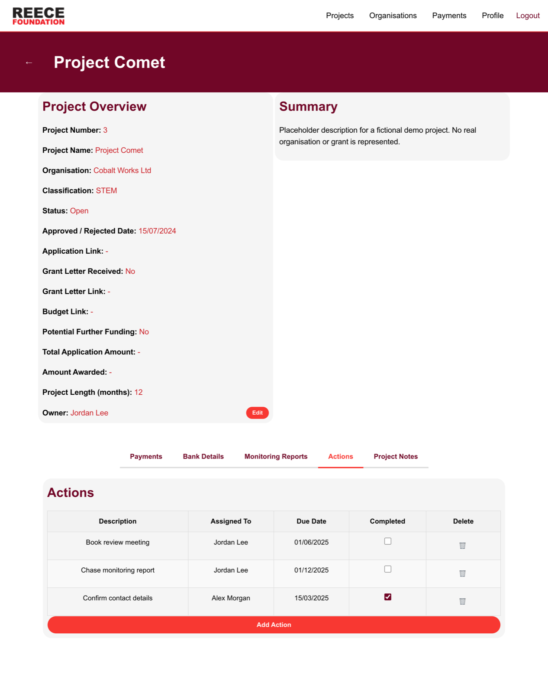
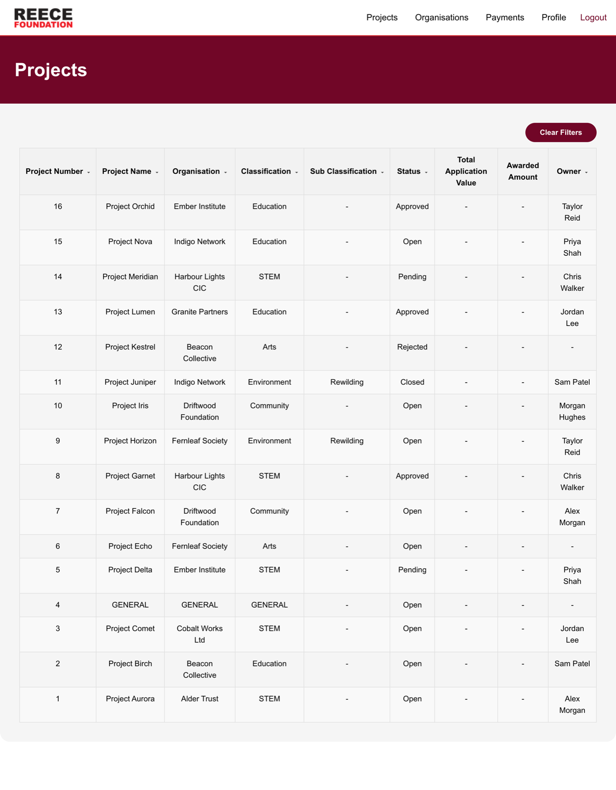
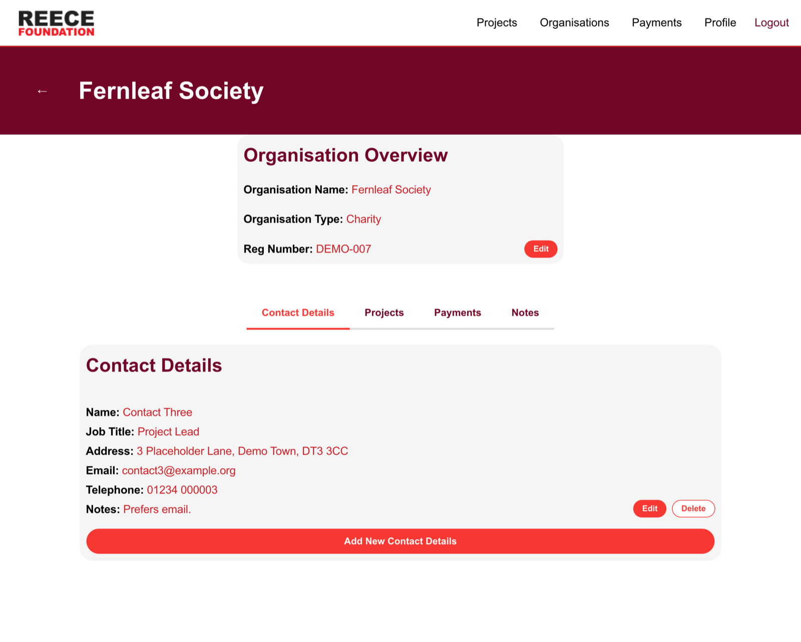

# Reece Foundation Grants Portal

A web app for managing a charitable foundation's grants, from first application through to final payment. I built it for the Reece Foundation, and it's deployed on Heroku.

> **About this copy:** this is a portfolio copy of a private repository. All of the organisations, projects, people and logins in the seed data are made up, and the commit history starts fresh.

## Screenshots

All data shown is placeholder demo data. Financial values are left blank in the demo.

**Project page:** details for one grant, with tabs for payments, bank details, monitoring reports, actions and notes.



**Projects list:** every application and grant, with sortable and filterable columns.



**Organisation page:** contact details, projects, payments and notes for a funded organisation.



## What it does

- **Organisations:** keep a record of each organisation the foundation funds, with contact details and notes.
- **Applications and projects:** log new grant applications and track each one through Pending, Approved or Rejected, then Open and Closed. Projects can have several classifications and sub-classifications (for example Education → Primary).
- **Project summary:** one page per project with its notes, a to-do list of actions with owners and due dates, monitoring reports, bank details and payments.
- **Upcoming payments:** payments due in a chosen month, which can be filtered to unpaid ones and exported. Payments can also be uploaded in bulk from an Excel sheet. The upload shows a preview first, flags invalid or duplicate rows, and only imports once confirmed.
- **Search:** find projects by number, name, organisation or classification.
- **Sign-in:** every page is behind Spring Security form login, and passwords are stored as BCrypt hashes.

## Tech stack

- Java 21, Spring Boot 3.5 (Web, Data JPA, Security, Validation)
- Thymeleaf server-rendered templates, with a little plain JavaScript
- PostgreSQL, with the schema managed by Flyway migrations
- Apache POI for reading Excel uploads
- JUnit and MockMvc tests
- Deployed on Heroku

## Running it locally

You'll need Java 21 and PostgreSQL.

1. Create an empty database:

   ```bash
   createdb reece_foundation
   ```

2. Start the app. On first run, Flyway creates the tables and loads the demo data.

   ```bash
   ./gradlew bootRun
   ```

   To use a different database, set `JDBC_DATABASE_URL`, for example `jdbc:postgresql://localhost:5432/my_db`.

3. Open http://localhost:8080 and sign in with the demo account:

   - Email: `demo@example.com`
   - Password: `demo-password`

To run the tests (they need the database running too):

```bash
./gradlew test
```

## Project layout

```
src/main/java/.../controller     Request handling, one controller per area
src/main/java/.../model          JPA entities and form objects
src/main/java/.../repository     Spring Data repositories
src/main/java/.../config         Security and form-binding setup
src/main/resources/db/migration  Flyway migrations (schema and demo data)
src/main/resources/templates     Thymeleaf pages
```
